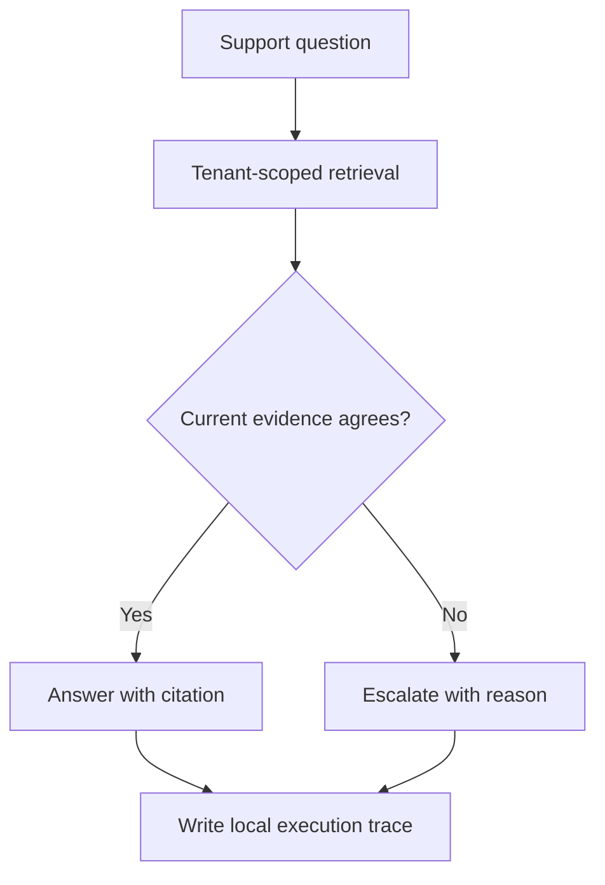

# Starlight Developer Showcase

Run a support agent against a test corpus, build a portable interview skill, or
inspect an editable film recipe. Start with the demo that matches the decision
you need to make.

| Public repository | Use it to | License |
| --- | --- | --- |
| [Starlight Agent Skills](https://github.com/Starlight-Intelligence/starlight-agent-skills) | Install portable instructions for engineering, research and creative production | [MIT](../LICENSE) |
| [Agentic Architecture Field Guide](https://github.com/AI-Architect-Studio/agentic-architecture-field-guide) | Test a small support-agent boundary and adapt the client delivery kit | [MIT](https://github.com/AI-Architect-Studio/agentic-architecture-field-guide/blob/0daaa5a583648f455d2fb4acf5df1a62785e4a6f/LICENSE) |
| [GenInvestor Skills](https://github.com/frankxai/geninvestor-skills) | Audit a diligence memo against its primary records | [Apache-2.0](https://github.com/frankxai/geninvestor-skills/blob/d8de35a0dd9fd17667d8b0d32c63307d885207f2/LICENSE) |

## Install five skills

Run from an empty workspace with Git and a skill-capable client. Install only
the folders you want by removing their lines. The source revisions below pin
the review inputs. Keep each skill's license and notices with redistributions.

```sh
git clone https://github.com/Starlight-Intelligence/starlight-agent-skills.git
git -C starlight-agent-skills checkout --detach 1e5577124c7c8ff48fceaf66037e0d5723cb41cf
git clone https://github.com/frankxai/geninvestor-skills.git
git -C geninvestor-skills checkout --detach d8de35a0dd9fd17667d8b0d32c63307d885207f2

skill_dir=.agents/skills       # Codex. Use .claude/skills for Claude Code.
mkdir -p "$skill_dir"
cp -R starlight-agent-skills/skills/substrate/capability-foundry "$skill_dir/"
cp -R starlight-agent-skills/skills/coding/starlight-eng-review "$skill_dir/"
cp -R starlight-agent-skills/skills/research/claim-verification "$skill_dir/"
cp -R geninvestor-skills/skills/source-check "$skill_dir/"
cp -R starlight-agent-skills/skills/media/social-repurposer "$skill_dir/"
```

Start [Codex](https://developers.openai.com/codex/skills) or
[Claude Code](https://code.claude.com/docs/en/skills) in the workspace and invoke
the skill by name. Supplied local excerpts are enough for the worked examples
below. URL-based research or media work needs source access. Client inference
uses the operator's account and terms.

| Skill | Task to try | Output and dependency |
| --- | --- | --- |
| [Capability Foundry](../skills/substrate/capability-foundry) | Package a source-linked interview synthesis brief for Claude Code and Codex | Skill draft plus a SHA-256 file receipt. The optional public compiler is exercised in demo 2. |
| [Starlight Engineering Review](../skills/coding/starlight-eng-review) | Check whether the support reference can be exposed to multiple customers | Advisory release verdict, trust boundary, required tests and rollback. Provide source and architecture. |
| [Claim Verification](../skills/research/claim-verification) | Check whether the support demo passed its declared release gates | Verdict, exact decisive evidence and scope caveats. Provide excerpts or enable source retrieval. |
| [Source Check](https://github.com/frankxai/geninvestor-skills/tree/d8de35a0dd9fd17667d8b0d32c63307d885207f2/skills/source-check) | Verify a fictional founder's claim that six pilot studios paid | Claim-by-claim memo with units, dates and source locations. Use the [pinned public case and replay](https://github.com/frankxai/geninvestor-skills/tree/905cdff265da5f65b4279e9b86f0c3fb3b59fb48/examples/paying-studios). |
| [Social Repurposer](../skills/media/social-repurposer) | Turn the Field notes lesson into a short script and newsletter note | Channel-specific drafts that retain the public lesson link and asset credit. Provide the lesson text or allow the client to read it. |

### Worked outputs

These are excerpts from one walkthrough of the installed instructions using the
public fixtures below. The commands in the demo sections reproduce the underlying
evidence. The written skill outputs can vary across clients.

| Skill | Output from the walkthrough |
| --- | --- |
| Capability Foundry | **Draft** `interview-evidence-brief` for Claude and Codex. Independently matched 29 file hashes. Next check: feed a misleading quote and confirm it cannot become a finding without evidence. |
| Starlight Engineering Review | **Block hosted rollout.** The reference constructor accepts the tenant from its caller. A serving adapter must derive tenant identity from the authenticated session. Require two identities, cross-tenant read denial and replay after recovery. Roll back by disabling the hosted adapter and retaining the local reference. |
| Claim Verification | **Refuted, high confidence.** The claim “the support reference passed its declared release gates” conflicts with `DECLARED_GATES_FAIL` in the evaluator output. Case coverage was 10/10. Unknown total cost and preserved error attempts still affect this gate. |
| Source Check | **Fail.** Six of eight *workspaces* carried paid-plan flags (S2). Three of six *external studios* had positive net receipts (S1, S3 L1–L5), or 50%. Removing S3 leaves that rate unknown. S4 establishes two unassisted deliveries among the three recorded cuts. |
| Social Repurposer | **Newsletter draft.** A paper fold, a gathering of marked pages and a bound book tell the story in three shots. Try switching between wide and detail in the [Field notes lesson](https://gencreator.ai/creator-studio/production/director), then export the framing you chose. Keep [the source provenance](https://gencreator.ai/demos/field-notes/provenance.json) with derivative work. |

## 1. See a support agent answer, escalate and recover

**What to say in a meeting:** “Here is the same support task on the happy path,
with a missing source, and after interruption. Let's inspect what the agent
actually did.”

```sh
git clone https://github.com/AI-Architect-Studio/agentic-architecture-field-guide.git
cd agentic-architecture-field-guide
git checkout --detach 0daaa5a583648f455d2fb4acf5df1a62785e4a6f
node examples/support-agent-reference/run.mjs --out-dir support-trial-001
node scripts/release-evidence.mjs support-trial-001/policy.json support-trial-001/runs.json --markdown
```

Use Node.js 22 or later and a new output directory for each run. Expect
11 attempts across 10 cases. `evidence.json` records the answer **“Use Settings
→ Access → Reset token. The previous token stops working immediately.”** with
source `KB-101` revision 1. An unsupported question escalates. The evaluator
intentionally exits **2** with `DECLARED_GATES_FAIL` because total cost is unknown
and the trace preserves timeout and forbidden-tool attempts.



This is a deterministic assistant over synthetic data. The local run requires
no account or external model/API spend. Hosting cost and model quality are
outside the example's measurements. See the
[reference boundaries](https://github.com/AI-Architect-Studio/agentic-architecture-field-guide/tree/0daaa5a583648f455d2fb4acf5df1a62785e4a6f/examples/support-agent-reference)
before adapting the code.

## 2. Compile a source-linked interview skill

**What to say:** “I can hand the same capability to two teams and verify each
generated file before either team installs it.”

From this repository's root, use Python 3.9+ and network access.

```sh
python3 scripts/developer-demo.py foundry
python3 scripts/developer-demo.py foundry --full > interview-evidence-brief.json
```

The public compiler returned 29 hashed files plus `receipt.json`, with both
targets marked `draft`. The command recomputes every file hash and the combined
receipt hash. It rejects an incomplete input. The tested package receipt ended
in `917fce2`. A draft still needs owner review, host validation and a distribution
license. No account or payment is required for this public example.

## 3. Take an editable directing recipe into the browser

**What to say:** “The lesson survives the interface. This three-shot recipe can
be saved, edited and reopened.”

```sh
python3 scripts/developer-demo.py director
python3 scripts/developer-demo.py director > field-notes-lesson.json
python3 -c 'import json, sys; print(json.dumps(json.load(sys.stdin)["recipe"], indent=2))' \
  < field-notes-lesson.json > field-notes-recipe.json
```

Expect the Field notes recipe with **The fold**, **The gathering**, and **The bound
edition**. The response reports zero credits, zero model calls and zero external
writes. Open the [public lesson](https://gencreator.ai/creator-studio/production/director)
to edit and export its own portable recipe. Import `field-notes-recipe.json` to reopen the example in the lesson.
The lesson and its source media retain their published usage terms.

## API and MCP

Use [Streamable HTTP](https://modelcontextprotocol.io/specification/2025-03-26/basic/transports)
with JSON-RPC POST. The sample client performs `initialize`,
`notifications/initialized`, `tools/list` and `tools/call`. It uses the
negotiated version and forwards any assigned session ID. `tools/list` exposes
the live input schemas. A tool-level error can arrive with HTTP 200, so read the
JSON-RPC error or the tool's `isError` flag. Each request has a 25-second timeout.

| Endpoint | Safe example | Contract |
| --- | --- | --- |
| [Starlight Intelligence MCP](https://starlightintelligence.ai/mcp) | `compile_capability` | Name, description, outcome, kind and target list → draft files, targets and SHA-256 receipt. [Foundry workflow](../skills/substrate/capability-foundry/SKILL.md) |
| [Starlight Academy MCP](https://starlightintelligence.academy/mcp) | `get_academy` | Empty object → academy, teachers and challenges |
| [Agentic Income MCP](https://www.agenticincome.ai/api/mcp) | `calculate_unit_margin` | Positive price hypothesis and optional cost lines → modeled fees, proceeds and margin. The server streams JSON-RPC over SSE. |
| [GenCreator MCP](https://gencreator.ai/api/mcp) | `gencreator_get_director_lesson` | Empty object → public lesson, shots, recipe and usage. [JSON manifest](https://gencreator.ai/api/mcp/manifest) |

`python3 scripts/developer-demo.py check` reads the Academy catalog and models a
$67 sale using the calculator's current [Polar fee input](https://polar.sh/resources/pricing).
The observed result was $3.85 in modeled fees and $63.15 after that fee. This
scenario excludes all cost lines you do not enter and proves no sale or
merchant relationship. Hosted operating costs for these public calls were
unmeasured.

## Founding-customer architecture pilot

For a CTO, venture platform lead or founder with an agent workflow about to
enter a real operating environment. Bring one workflow, its intended users,
the sensitive-data boundary and the decision you need to make.

The proposed scoped engagement delivers an architecture decision record, an
execution trace over approved example data, an acceptance checklist covering
failure and recovery, and a client-owned handoff with named next decisions.
Acceptance requires your team to rerun the agreed example and locate the
evidence supporting the go/no-go decision. Scope, fee, reuse rights and support
are agreed before work begins. The public kit and examples are free under the
licenses above. Implementation and private review are available by inquiry.
The [Income Flywheel Starter Kit](https://www.agenticincome.ai/delivery/starter-kit)
is a separate free, on-site kit. The paid Blueprint checkout and managed
CreatorPack delivery are currently unavailable.

[Inquire through FrankX](https://www.frankx.ai/contact). Use “Architecture pilot”
as the subject and include the workflow, the decision owner and target date.
